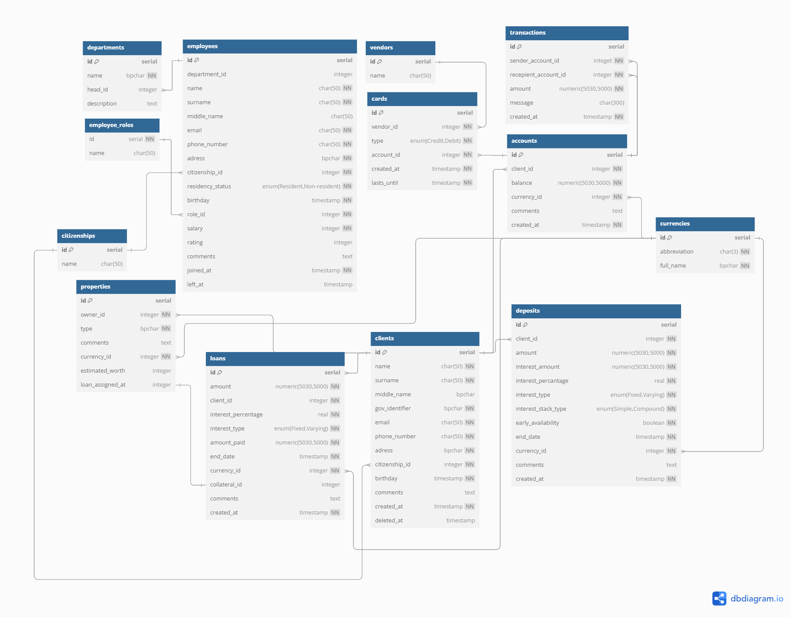
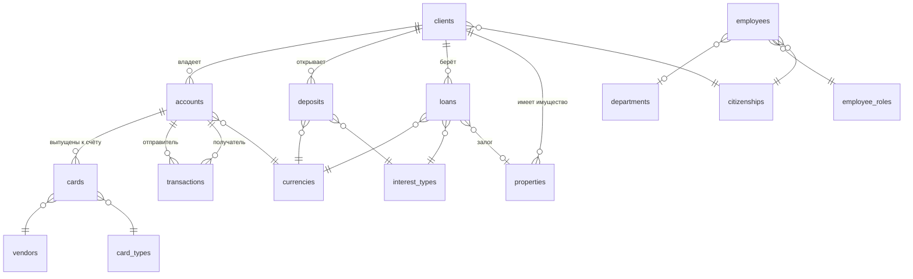

<div align="center">

# dm_dbms

**Реляционная модель банка на PostgreSQL: 15 таблиц, триггеры целостности, хранимые процедуры для переводов, вкладов и кредитов.**

[](src/creating.sql)
[](src/func.sql)
[](src/quering.sql)
[](data_diagram.png)

[Возможности](#возможности) ·
[Схема данных](#схема-данных) ·
[Быстрый старт](#быстрый-старт) ·
[Бизнес-логика в базе](#бизнес-логика-в-базе) ·
[Запросы](#запросы) ·
[Структура репозитория](#структура-репозитория)

</div>

---

Учебный проект по проектированию базы данных для банка: клиенты, счета, карты, переводы, вклады, кредиты с залогом, сотрудники и отделы. Вся предметная логика живёт в самой базе: триггеры следят за балансами, хранимые процедуры оформляют операции атомарно, отчётные функции отдают готовые срезы по клиенту. Цель проекта: получить опыт проектирования схемы, написания SQL-запросов разной сложности и переноса бизнес-правил в PL/pgSQL.

## Возможности

- **Нормализованная схема из 15 таблиц.** Девять предметных (`clients`, `accounts`, `transactions`, `deposits`, `loans`, `properties`, `cards`, `employees`, `departments`) и шесть справочников (`currencies`, `citizenships`, `vendors`, `employee_roles`, `interest_types`, `card_types`). Повторяющиеся значения вынесены в справочники и связаны внешними ключами.
- **Целостность на уровне СУБД.** Внешние ключи `REFERENCES`, `NOT NULL`, `CHECK`-ограничения (`balance > 0`, `amount > 0`, `salary > 0`, `birthday < CURRENT_TIMESTAMP`), значения по умолчанию `DEFAULT CURRENT_TIMESTAMP`.
- **Мягкое удаление.** Клиенты, счета, вклады и сотрудники не удаляются физически: поля `deleted_at`, `closed_at`, `left_at`. Отчёты и выборки учитывают только активные записи.
- **Триггеры вместо ручных проверок.** Перед переводом проверяется баланс отправителя, после перевода балансы обоих счетов пересчитываются, новому клиенту автоматически открывается основной счёт в USD, при удалении клиента помечаются удалёнными все его счета.
- **Хранимые процедуры с транзакциями.** Перевод средств, открытие вклада, выдача и одобрение кредита выполняются в блоке `BEGIN … EXCEPTION … ROLLBACK`: при любой ошибке изменения откатываются, исключение пробрасывается вызывающему.
- **Отчётные функции `RETURNS TABLE`.** Баланс по счетам клиента с валютой, его вклады, кредиты и карты, общая статистика банка; финансовый отчёт клиента через `OUT`-параметры.
- **Набор запросов для аналитики:** подзапросы и `EXISTS`, CTE, все виды `JOIN`, агрегаты с `GROUP BY`/`HAVING`, `UNION`, оконная функция `ROW_NUMBER() OVER (PARTITION BY …)`, представление `CREATE VIEW`, план запроса через `EXPLAIN`.
- **Тестовые данные** для всех 15 таблиц в одном файле.
- **ER-диаграмма** в DBML (dbdiagram.io) и в виде изображения.

## Схема данных

<p align="center">
  
</p>



<details>
<summary><b>Таблицы</b></summary>

| Таблица | Назначение | Ключевые поля |
|---|---|---|
| `clients` | клиенты банка | ФИО, контакты, `citizenship_id`, `birthday`, `deleted_at` |
| `accounts` | счета клиентов | `client_id`, `balance`, `currency_id`, `deleted_at` |
| `transactions` | переводы между счетами | `sender_account_id`, `recipient_account_id`, `amount`, `message` |
| `deposits` | вклады | `amount`, `interest_percentage`, `interest_type`, `early_availability`, `end_date`, `closed_at` |
| `loans` | кредиты | `amount`, `amount_paid`, `interest_percentage`, `collateral_id`, `end_date` |
| `properties` | имущество клиента, используется как залог | `owner_id`, `type`, `estimated_worth`, `currency_id` |
| `cards` | карты к счёту | `vendor_id`, `type`, `account_id`, `lasts_until` |
| `employees` | сотрудники | `department_id`, `role_id`, `salary`, `rating`, `joined_at`, `left_at` |
| `departments` | отделы | `name`, `description` |
| `currencies`, `citizenships`, `vendors`, `employee_roles`, `interest_types`, `card_types` | справочники | `id`, `name` / `abbreviation` |

</details>

## Быстрый старт

Нужен PostgreSQL 14 или новее и клиент `psql`.

```bash
git clone https://github.com/StarkSpecter/dm_dbms.git
cd dm_dbms
createdb bank
psql -d bank -f src/creating.sql    # таблицы и ограничения
psql -d bank -f src/func.sql        # триггеры, процедуры, функции
psql -d bank -f src/inserting.sql   # тестовые данные
```

Дальше примеры из `src/quering.sql` можно выполнять по одному в `psql` или в любом SQL-клиенте (DataGrip, DBeaver, pgAdmin).

### Первый перевод

```sql
CALL transfer_funds(1, 2, 150.00, 'За обед');

SELECT * FROM view_account_balance(1);
--  balance | currency | comments
-- ---------+----------+----------------
--   850.00 | USD      | Основной счет
```

Если денег не хватает, триггер остановит операцию до изменения данных:

```
ERROR:  Недостаточно средств на счёте отправителя (ID: 1). Баланс: 850.00, Требуется: 5000
```

## Бизнес-логика в базе

### Триггеры

| Триггер | Событие | Что делает |
|---|---|---|
| `trg_check_balance` | `BEFORE INSERT ON transactions` | сравнивает баланс отправителя с суммой, при нехватке `RAISE EXCEPTION` |
| `trg_update_balances` | `AFTER INSERT ON transactions` | списывает сумму у отправителя и зачисляет получателю |
| `trg_create_default_account` | `AFTER INSERT ON clients` | открывает новому клиенту основной счёт в USD |
| `trg_mark_accounts_deleted` | `BEFORE UPDATE OF deleted_at ON clients` с условием `WHEN` | при мягком удалении клиента проставляет `deleted_at` всем его счетам |

### Процедуры и функции

| Объект | Назначение |
|---|---|
| `transfer_funds(sender, recipient, amount, message)` | перевод в одной транзакции: проверка, списание, зачисление, запись в `transactions`; откат при ошибке |
| `create_transaction(…)` | обёртка над `transfer_funds` |
| `add_deposit(…)` / `open_deposit(…)` | открытие вклада, дата окончания считается из срока в месяцах через `INTERVAL` |
| `take_loan(…)` | оформление кредита с залогом |
| `approve_loan(loan_id)` | одобрение кредита только при наличии залога, иначе исключение |
| `get_client_financial_report(client_id, OUT …)` | суммы по счетам, вкладам и кредитам клиента в `OUT`-параметрах |
| `view_account_balance(client_id)` | активные счета клиента с валютой (`RETURNS TABLE`) |
| `view_deposits`, `view_loans`, `view_cards` | активные вклады, кредиты и карты клиента |
| `get_statistics()` | число клиентов и счетов, оборот переводов, суммы открытых вкладов и невыплаченных кредитов |

Часть объектов в `func.sql` определена дважды: более поздняя версия в файле переопределяет раннюю через `CREATE OR REPLACE`.

## Запросы

Файл `src/quering.sql` собран как учебный набор от простого к сложному:

- **Подзапросы и `EXISTS`:** клиенты с балансом выше 5000; граждане Беларуси, у которых есть и крупный счёт, и вклад; сотрудники IT-отдела с зарплатой выше средней по отделу (коррелированный подзапрос).
- **CTE:** все переводы клиента, где он отправитель или получатель; та же выборка завёрнута в представление `friedrich_transactions` и разобрана через `EXPLAIN`.
- **Соединения:** `INNER JOIN` клиентов со счетами и валютой, `LEFT JOIN` для клиентов без вкладов, `CROSS JOIN` для декартова произведения.
- **Агрегаты:** `MIN`/`MAX`/`AVG`/`SUM` по балансам, средний баланс по валютам, число клиентов по гражданствам, фильтр групп через `HAVING`.
- **`UNION`:** общий список людей из `clients` и `employees`; валюты, встречающиеся во вкладах и на счетах.
- **Оконные функции:** `ROW_NUMBER() OVER (PARTITION BY client ORDER BY balance DESC)` для топ-3 счетов каждого клиента.

## Структура репозитория

```
src/
├── creating.sql     15 таблиц, внешние ключи, CHECK-ограничения, запросы к information_schema
├── func.sql         4 триггера, хранимые процедуры и отчётные функции на PL/pgSQL
├── inserting.sql    тестовые данные для всех таблиц
└── quering.sql      запросы: подзапросы, CTE, JOIN, агрегаты, UNION, VIEW, оконные функции, EXPLAIN
data_diagram.png     ER-диаграмма (dbdiagram.io)
requirements.md      требования к прикладному слою поверх базы: аккаунты, роли, журнал действий
README.md            этот файл и исходная DBML-модель
```

Прикладной слой из `requirements.md` (авторизация, роли, журналирование) в репозитории не реализован: проект ограничен схемой данных и логикой на стороне СУБД.
